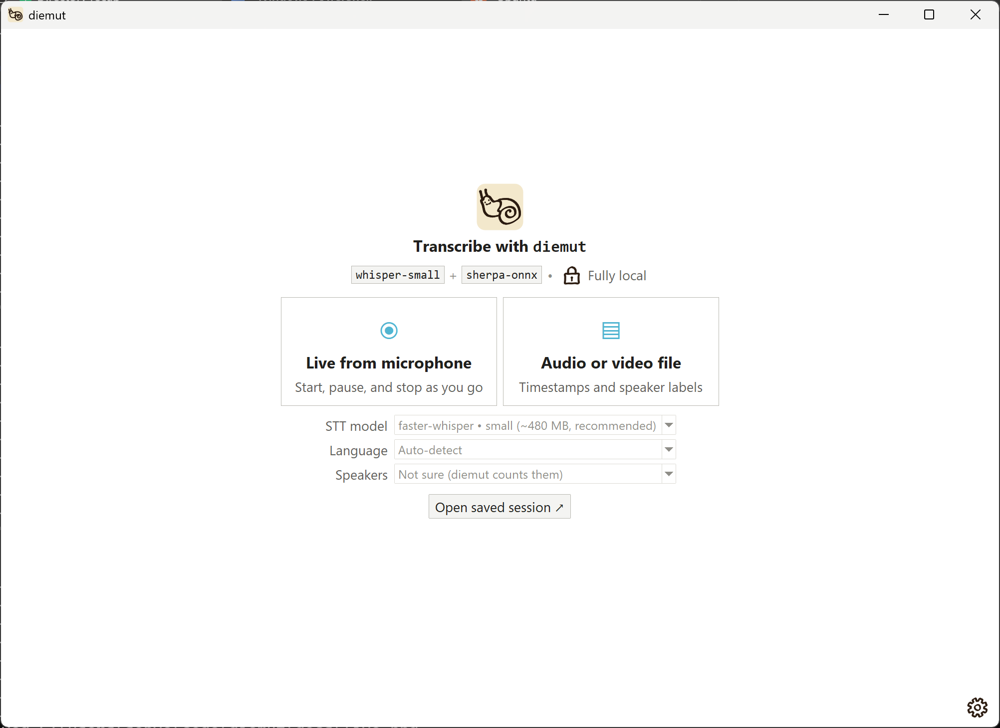
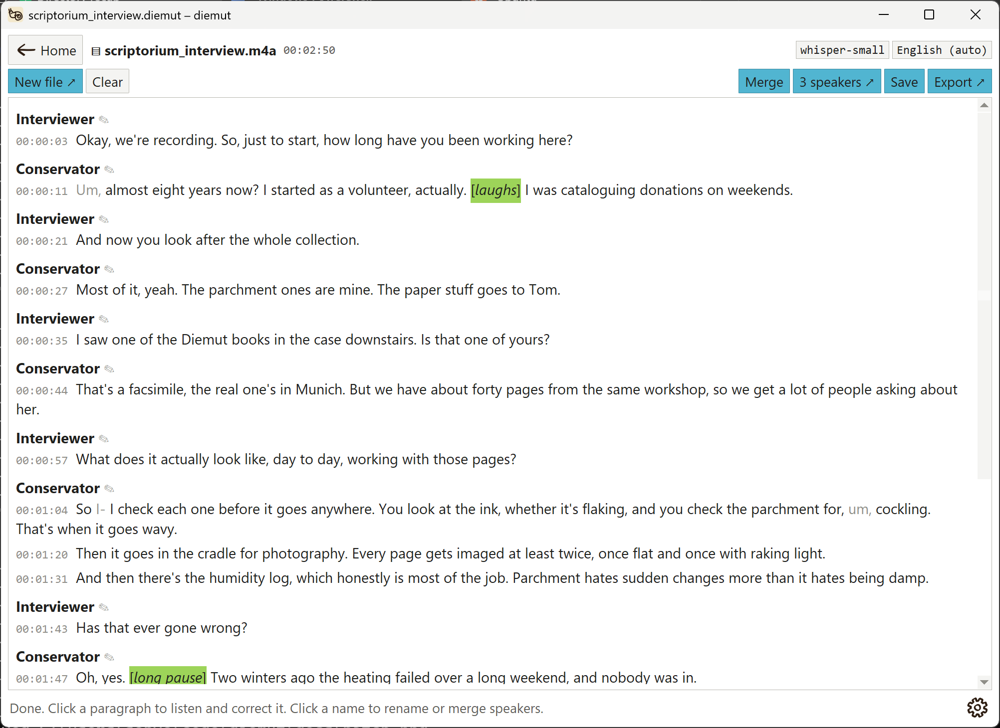
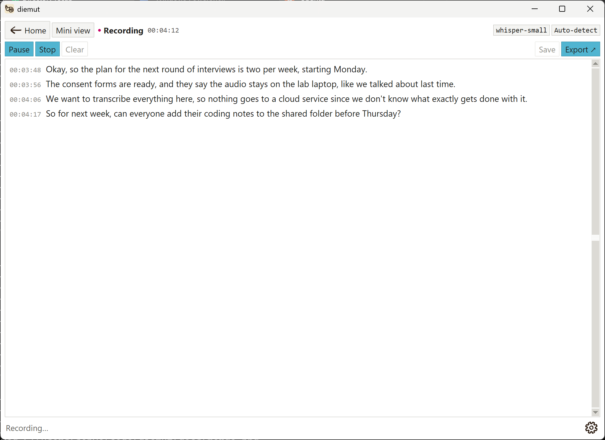
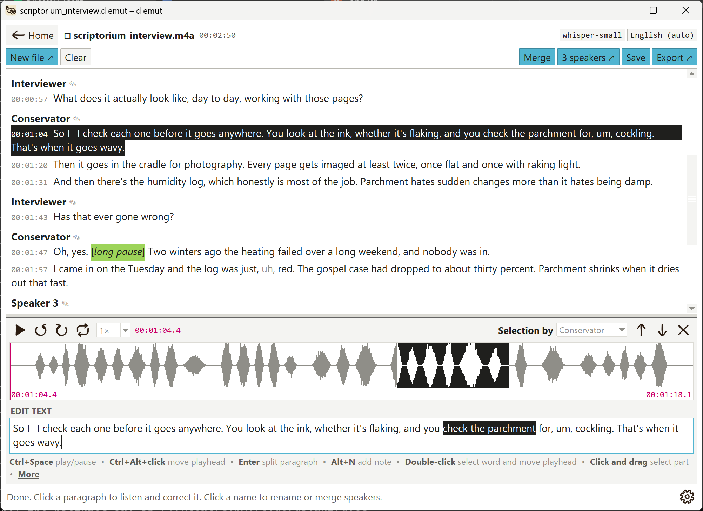

# diemut

`diemut` (DEE-moot) turns speech into text on your own computer. It can transcribe your microphone live or an audio/video file, label who is speaking, and export the result as `.txt`, `.vtt` or `.srt` (subtitles) or `.docx` (Word).

Everything runs locally. Your audio never leaves your computer; the only internet use is downloading the models the first time you need them.

**AI Disclosure:** Other than my snail drawing, this was basically fully vibe-coded with Claude!

**Fun fact:** "Diemut" is one way of latinizing "[Diemoth](https://en.wikipedia.org/wiki/Diemoth)," which was the name of a medieval scribe in Upper Bavaria, Germany (~11th century). I chose it semi-randomly from the English Wikipedia list of [medieval European scribes](https://en.wikipedia.org/wiki/Category:Medieval_European_scribes). 

| Start screen | Transcribing a file | Live from microphone | Editing text |
|---|---|---|---|
|  |  |  |  |

*(Screenshots are of `diemut` on Windows. On macOS and Linux it looks much the same but uses your system's fonts. The transcripts are made up, and so is the audio.)*

**→ [User guide](docs/guide.md)**: how to use every part of `diemut`.

## What it does

- **Live from microphone:** Start, Pause/Resume and Stop. Text appears a few seconds after you speak, grouped into paragraphs at natural pauses.
- **Audio or video files:** mp3, wav, m4a, mp4, mkv, mov and more. You get timestamps, speaker labels (Speaker 1, Speaker 2…, which you can rename by clicking them) and paragraphs.
- **Listen and correct:** click any paragraph to play its audio, fix the text, or move it to a different speaker.
- **Export** to `.txt`, `.vtt`, `.srt` and `.docx`. Speaker names and paragraphs carry over to every format.
- **Save sessions** as `.diemut` files and open them again later to carry on correcting.
- **100 languages**, plus a *Multiple languages* option for recordings that switch between languages.

Under the hood, `diemut` uses two models:

- **`whisper-small`** for speech-to-text: OpenAI's Whisper, run with faster-whisper. You can pick a larger or smaller model on the start screen.
- **`sherpa-onnx`** for speaker labels.

Paragraph breaks don't come from a model. `diemut` starts a new paragraph when there's a pause of more than 1.5 seconds between words (using Whisper's word timings), when the speaker changes, or at the end of a sentence once a paragraph passes about 600 characters. You can split and merge paragraphs yourself, too. The two settings are `PARAGRAPH_PAUSE` and `PARAGRAPH_SOFT_MAX` in `diemut/speakers.py`.

---

## Setup on Linux (Ubuntu/Debian)

```bash
sudo apt install python3-venv python3-tk libportaudio2
git clone https://github.com/sohyeonhwang/diemut.git
cd diemut
python3 -m venv .venv
source .venv/bin/activate
pip install .
diemut
```

## Setup on macOS

1. Install **Python 3.14** (not 3.15 yet) from [python.org/downloads/macos](https://www.python.org/downloads/macos/). Use the python.org installer: it includes the window toolkit `diemut` needs, which Homebrew's Python sometimes doesn't.
2. Get `diemut` (with `git clone` as in the Linux steps above, or the ZIP as in the Windows steps below), then open **Terminal** in the `diemut` folder.
3. Install and run:
   ```bash
   python3.14 -m venv .venv
   source .venv/bin/activate
   pip install .
   diemut
   ```
4. The first time you use live mode, macOS asks whether Terminal may use the microphone. Click **Allow**. If you missed it, go to **System Settings → Privacy & Security → Microphone** and turn on Terminal.

To run it again later: `cd` into the folder, run `source .venv/bin/activate`, then `diemut`.

---

## Setup on Windows

> **Using WSL?** Run `diemut` with **Windows** Python, not inside WSL. `diemut` needs a window and your microphone, and both are unreliable through WSL. You can keep using WSL for everything else.

### 1. Install Python

1. Go to [python.org/downloads/windows](https://www.python.org/downloads/windows/), find the newest **Python 3.14** release (3.14.something), and click **Download Windows installer (64-bit)**. Don't use Python 3.15 yet: one of the parts `diemut` relies on (onnxruntime) doesn't support it.
2. Run the installer. On the first screen, **tick "Add python.exe to PATH"**, then click *Install Now*.
3. Open **PowerShell**: press the Windows key, type `powershell`, and press Enter. Check that Python works:
   ```powershell
   py -3.14 --version
   ```
   You should see something like `Python 3.14.x`.

### 2. Get diemut

Put `diemut` in a folder that **isn't synced by OneDrive**. Documents and Desktop often are, and syncing causes slowdowns and odd errors. `C:\Users\<your name>\code\diemut` is a good choice.

**If you have Git:**
```powershell
mkdir $HOME\code
cd $HOME\code
git clone https://github.com/sohyeonhwang/diemut.git
cd diemut
```

**If you don't:** on the GitHub page, click the green **Code** button, then **Download ZIP**. Unzip it into `C:\Users\<your name>\code\`, and rename the folder to `diemut` if it's called something like `diemut-main`. Then:
```powershell
cd $HOME\code\diemut
```

### 3. Create a virtual environment

A virtual environment is a private set of Python packages just for diemut, so it won't interfere with anything else on your computer.

```powershell
py -3.14 -m venv .venv
.venv\Scripts\Activate.ps1
```

Your prompt should now start with `(.venv)`.

If PowerShell says *"running scripts is disabled on this system"*, run this once, then try the `Activate.ps1` line again:
```powershell
Set-ExecutionPolicy -Scope CurrentUser RemoteSigned
```

### 4. Install diemut

```powershell
pip install .
```

This takes a few minutes the first time.

### 5. Run it

```powershell
diemut
```

### 6. Allow microphone access (for live mode)

Open **Settings → Privacy & security → Microphone**, and turn on both **"Microphone access"** and **"Let desktop apps access your microphone"**.

### Running `diemut` again later

Open PowerShell and run:
```powershell
cd $HOME\code\diemut
.venv\Scripts\Activate.ps1
diemut
```

---

## The first run

The first time you use each model, `diemut` downloads it. The status bar shows the progress.

| What | Size | Saved in |
|---|---|---|
| Whisper model (default: small) | ~480 MB | `~/.cache/huggingface/hub` |
| Speaker models (first file you transcribe) | ~47 MB | `~/.cache/diemut/models` |

On Windows, `~` means `C:\Users\<your name>`. After these downloads, `diemut` works offline. To keep the speaker models somewhere else, such as a shared lab drive, set the environment variable `DIEMUT_HOME` to that folder.

## Quick start

1. Run `diemut`, and choose a model and language on the start screen.
2. Click **Live from microphone** and press **Start**, or click **Audio or video file** and choose one or more files.
3. Click any paragraph to listen to it and correct it.
4. **Save** keeps everything as a `.diemut` session you can open again; **Export ↗** saves `.txt`, `.vtt`, `.srt` or `.docx`.

Everything else (speakers, notes, merging paragraphs, find and replace, shortcuts, settings) is in the **[user guide](docs/guide.md)**. If something goes wrong, see [Troubleshooting](docs/guide.md#troubleshooting).

## Project layout

```
diemut/
├── __main__.py     starts the app
├── ui.py           the window: start screen, transcript screen, live mini view
├── editor.py       the correction panel (listen, correct, save)
├── paragraphs.py   merging and splitting paragraphs
├── batch.py        several files at once (batchview.py: switching, cancelling)
├── dialogs.py      small windows: Speakers, Export, Settings, Shortcuts, Find, questions, tooltips
├── find.py         finding and replacing text
├── notes.py        notes ([laughs]) in the transcript
├── theme.py        colours, fonts, button styles, icons and mouse pointers
├── images.py       faded copies of the icons for disabled buttons
├── transcribe.py   Whisper (files and live), model choices, live-mode timing
├── speakers.py     speaker labels and paragraph grouping
├── timing.py       keeps word timings when you correct a paragraph
├── playback.py     audio playback in the correction panel (pause, loop, slower speeds)
├── export.py       .txt, .vtt, .srt, .docx, and .mp3 for live audio
├── fillers.py      filler words and false starts
├── history.py      undo and redo
├── sessions.py     saving and opening sessions, and the recovery copy
├── settings.py     the settings diemut remembers
└── languages.py    the language list
docs/
├── guide.md        the user guide
└── images/         screenshots
```

Settings you might want to adjust are constants near the top of each file. For example, `PARAGRAPH_PAUSE` in `speakers.py` sets how long a pause must be before a new paragraph starts.

## Improvements + Contributing

`diemut` is deliberately small for now. These are directions I think would be useful improvements.

Contributions and suggestions are welcome; open an issue to discuss before starting on something big, but in general feel free to take on a chunk below. Everyone taking part is expected to follow our [Code of Conduct](CODE_OF_CONDUCT.md).

**Important:** `diemut` exists so recordings and transcripts never have to leave a machine you control. That matters for research data, interviews, and anything confidential. Cloud speech-to-text APIs (OpenAI, Google, AWS, AssemblyAI and others) send your audio to someone else's servers, so `diemut` won't include them by default. If one is ever added, it should be strictly opt-in, clearly labelled as *not local* everywhere it appears, and never the default. Local options should always come first! Personally, I think a transcription need only be good enough because I always manually listen back and correct transcriptions. The listening back is a valuable exercise (even at 1.5x speed :3).

### Packaging as a clickable app

A downloadable installer, so people can use `diemut` without installing Python or typing commands:
- Build a standalone app with PyInstaller (one-folder mode, which starts faster than one-file mode), and wrap it in an installer: Inno Setup for Windows, and a `.dmg` for macOS.
- Use GitHub Actions to build the Windows and Mac versions automatically and attach them to each release.
- Models would still download on first use, to keep the installer small.
- Without code signing, Windows and macOS show a security warning on first launch. Signing costs money every year, so at first a note in the README explaining how to get past the warning may be enough.

### Learning from corrections

Every correction a person makes in `diemut` is evidence of what the model gets wrong, especially names, jargon and accents particular to a group. Possible steps, from easiest to hardest:
1. **Custom vocabulary.** Keep a list of words people often correct (names, technical terms) and pass it to Whisper as hints. faster-whisper supports this through `hotwords` and `initial_prompt`. This is a quick win and needs no training.
2. **Saving correction pairs.** Optionally save each corrected paragraph's audio clip together with the corrected text, building a local dataset. This must be opt-in. Audio of people speaking is sensitive: it should be stored only locally, with clear deletion controls, and used only where the people recorded have consented (for research, in line with your ethics or IRB approval).
3. **Fine-tuning.** Use that dataset to fine-tune a Whisper model, for example with Hugging Face Transformers and LoRA, then convert it with CTranslate2's converter so `diemut` can load it. This needs a GPU and a fair amount of corrected audio. The fine-tuned model should be compared against the original on held-out recordings, to make sure it actually improved.

### Shared setup on a lab server

For a lab that shares one powerful machine:
- **Shared model storage (simplest).** Point every installation at one shared folder (`HF_HOME` for Whisper, `DIEMUT_HOME` for the speaker models) so large models are downloaded once.
- **`diemut` as a lab web app.** Run `diemut` on the lab server and use it through a web browser. Models load once on the server's GPU; people upload files, or record through the browser's microphone, and transcription jobs are queued. Audio and transcripts stay on lab-controlled hardware. This needs user accounts, HTTPS, per-person storage and a policy for how long recordings are kept.

### Settings, and other models

More in the Settings window, for choosing and adding models without editing code:
- Pick the speech-to-text model, the speaker-labelling engine, the device (CPU/GPU) and the CPU thread count.
- Load custom or fine-tuned Whisper models from a folder or a Hugging Face model name.
- Offer pyannote as a more accurate speaker-labelling option, for people willing to install PyTorch and use a free Hugging Face token. It still runs locally.
- Engines as plug-ins: each model is a small file that declares what it does and whether it is local, so the interface, including the "Fully local" label, updates automatically.
- Optional lab-wide defaults, such as the shared model folder.

### Other improvements

**Working with transcripts**
- Highlight words Whisper was unsure about (it reports a confidence for each word), so reviewing goes straight to the likely mistakes.
- A copy-edit helper for punctuation and obvious word fixes: a small language model, run locally like Whisper, that suggests corrections for a paragraph and shows each change clearly so it can be accepted or rejected.
- Keep fillers and false starts in languages other than English, too: the word-for-word prompt needs a short example sentence in each language, ideally checked by a speaker of it.

**Research workflows**
- More export formats: `.csv` or `.json` for qualitative analysis tools such as NVivo, ATLAS.ti and MAXQDA.
- Help with anonymisation: flag or replace names and other identifying details before transcripts are shared.

**Audio input**
- Transcribe the computer's own audio (for example, the other side of a video call), not just the microphone.

**Translation**
- Optional translation to English (or really, any other language), with every translated passage clearly marked in the window and in exports, so original speech and translation are never confused. This should work for distinguishing multiple original languages in the speech (e.g., if there is German, Korean, and Spanish in the transcript, and it's all translated to Spanish, the originally-German and originally-Korean components should be distinguishable).

**Quality and accessibility**
- Automated tests, and GitHub Actions to check that `diemut` installs on Windows, macOS and Linux.
- Dark mode, adjustable text size and full keyboard navigation.

**Prettier user interface**
- Making the UI a bit nicer and "prettier," but I don't mind the current version either. It does the job. Maybe a nice little `diemut` snail slugging along while things load...

## License

`diemut` is released under the MIT License (see `LICENSE`). The models and libraries it uses have their own licenses, listed in `THIRD_PARTY.md`.
