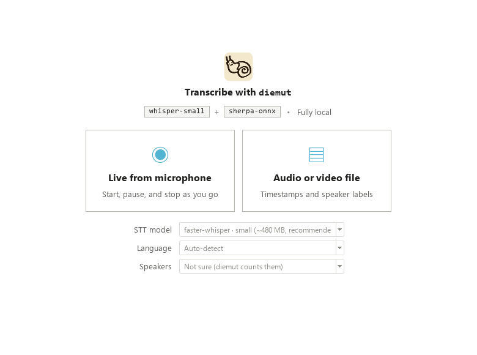
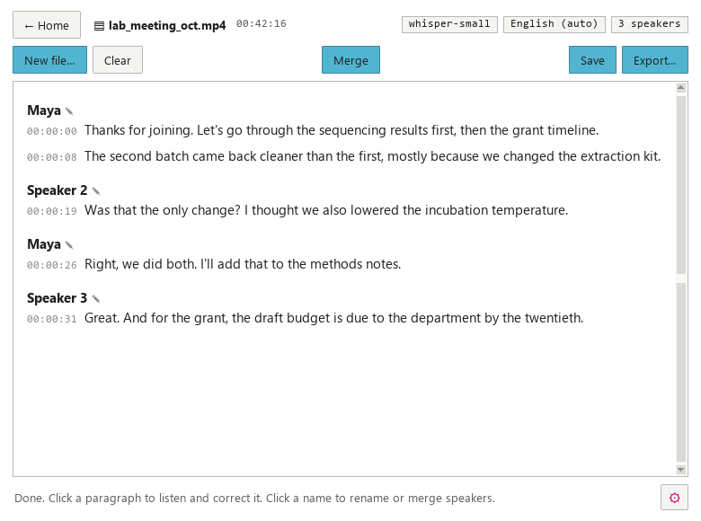
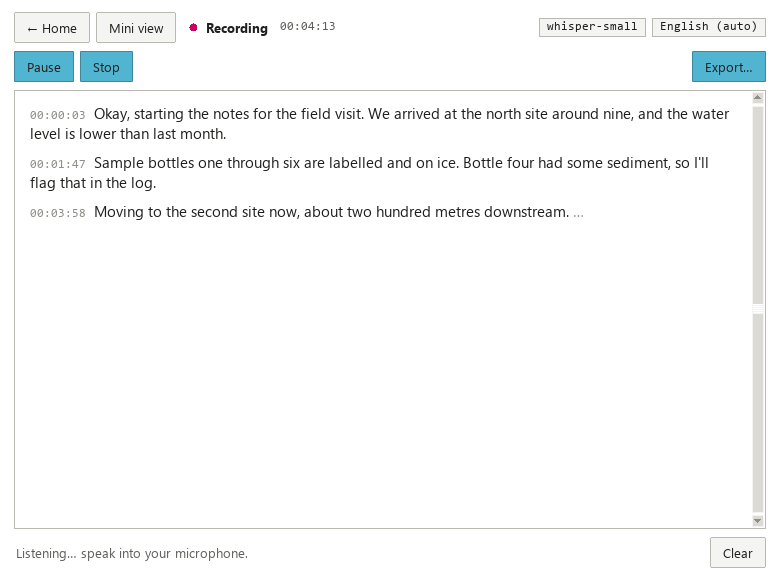
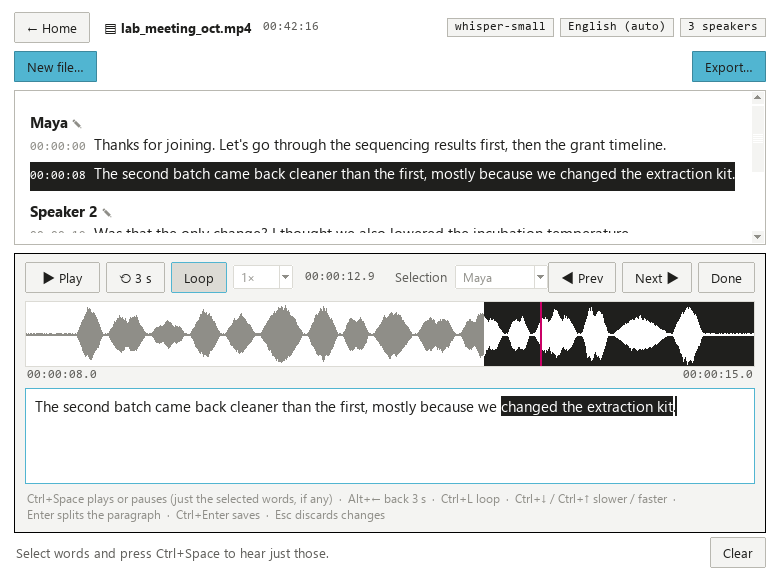

# diemut

`diemut` (DEE-moot) turns speech into text on your own computer. It can transcribe your microphone live or an audio/video file, label who is speaking, and export the result as `.txt`, `.vtt` (subtitles) or `.docx` (Word).

Everything runs locally. Your audio never leaves your computer; the only internet use is downloading the models the first time you need them.

**Disclaimer:** Other than my snail drawing, this was basically fully vibe-coded with Claude!

**Fun fact:** "Diemut" is one way of latinizing "[Diemoth](https://en.wikipedia.org/wiki/Diemoth)," which was the name of a medieval scribe in Upper Bavaria, Germany (~11th century). I chose it semi-randomly from the English Wikipedia list of [medieval European scribes](https://en.wikipedia.org/wiki/Category:Medieval_European_scribes). 

| Start screen | Transcribing a file | Live from microphone |
|---|---|---|
|  |  |  |

*(Simulated screenshots show* `diemut` *with Windows' fonts, Segoe UI and Consolas. On macOS and Linux it looks much the same but uses your system's fonts. Note these are not real transcripts, they're made up.)*

## What it does

- **Live from microphone:** Start, Pause/Resume and Stop. Text appears a few seconds after you speak, grouped into paragraphs at natural pauses.
- **Audio or video files:** mp3, wav, m4a, mp4, mkv, mov and more. You get timestamps, speaker labels (Speaker 1, Speaker 2…, which you can rename by clicking them) and paragraphs.
- **Listen and correct:** click any paragraph to play its audio, fix the text, or move it to a different speaker.
- **Export** to `.txt`, `.vtt` and `.docx`. Speaker names and paragraphs carry over to every format.
- **100 languages**, plus a *Multiple languages* option for recordings that switch between languages.

Under the hood, `diemut` uses two models:

- **`whisper-small`** for speech-to-text: OpenAI's Whisper, run with faster-whisper. You can pick a larger or smaller model on the start screen.
- **`sherpa-onnx`** for speaker labels.

Paragraph breaks don't come from a model. `diemut` starts a new paragraph when there's a pause of more than 1.5 seconds between words (using Whisper's word timings), when the speaker changes, or at the end of a sentence once a paragraph passes about 600 characters. You can split and merge paragraphs yourself, too. The two settings are `PARAGRAPH_PAUSE` and `PARAGRAPH_SOFT_MAX` in `diemut/speakers.py`.

---

## Setup on Linux (Ubuntu/Debian)

```bash
sudo apt install python3-venv python3-tk libportaudio2
git clone https://github.com/sohyeonhwang/diemut.git
cd diemut
python3 -m venv .venv
source .venv/bin/activate
pip install .
diemut
```

## Setup on macOS

1. Install **Python 3.14** (not 3.15 yet) from [python.org/downloads/macos](https://www.python.org/downloads/macos/). Use the python.org installer: it includes the window toolkit `diemut` needs, which Homebrew's Python sometimes doesn't.
2. Get `diemut` (with `git clone` as in the Linux steps above, or the ZIP as in the Windows steps below), then open **Terminal** in the `diemut` folder.
3. Install and run:
   ```bash
   python3.14 -m venv .venv
   source .venv/bin/activate
   pip install .
   diemut
   ```
4. The first time you use live mode, macOS asks whether Terminal may use the microphone. Click **Allow**. If you missed it, go to **System Settings → Privacy & Security → Microphone** and turn on Terminal.

To run it again later: `cd` into the folder, run `source .venv/bin/activate`, then `diemut`.

---

## Setup on Windows

> **Using WSL?** Run `diemut` with **Windows** Python, not inside WSL. `diemut` needs a window and your microphone, and both are unreliable through WSL. You can keep using WSL for everything else.

### 1. Install Python

1. Go to [python.org/downloads/windows](https://www.python.org/downloads/windows/), find the newest **Python 3.14** release (3.14.something), and click **Download Windows installer (64-bit)**. Don't use Python 3.15 yet: one of the parts `diemut` relies on (onnxruntime) doesn't support it.
2. Run the installer. On the first screen, **tick "Add python.exe to PATH"**, then click *Install Now*.
3. Open **PowerShell**: press the Windows key, type `powershell`, and press Enter. Check that Python works:
   ```powershell
   py -3.14 --version
   ```
   You should see something like `Python 3.14.x`.

### 2. Get diemut

Put `diemut` in a folder that **isn't synced by OneDrive**. Documents and Desktop often are, and syncing causes slowdowns and odd errors. `C:\Users\<your name>\code\diemut` is a good choice.

**If you have Git:**
```powershell
mkdir $HOME\code
cd $HOME\code
git clone https://github.com/sohyeonhwang/diemut.git
cd diemut
```

**If you don't:** on the GitHub page, click the green **Code** button, then **Download ZIP**. Unzip it into `C:\Users\<your name>\code\`, and rename the folder to `diemut` if it's called something like `diemut-main`. Then:
```powershell
cd $HOME\code\diemut
```

### 3. Create a virtual environment

A virtual environment is a private set of Python packages just for diemut, so it won't interfere with anything else on your computer.

```powershell
py -3.14 -m venv .venv
.venv\Scripts\Activate.ps1
```

Your prompt should now start with `(.venv)`.

If PowerShell says *"running scripts is disabled on this system"*, run this once, then try the `Activate.ps1` line again:
```powershell
Set-ExecutionPolicy -Scope CurrentUser RemoteSigned
```

### 4. Install diemut

```powershell
pip install .
```

This takes a few minutes the first time.

### 5. Run it

```powershell
diemut
```

### 6. Allow microphone access (for live mode)

Open **Settings → Privacy & security → Microphone**, and turn on both **"Microphone access"** and **"Let desktop apps access your microphone"**.

### Running `diemut` again later

Open PowerShell and run:
```powershell
cd $HOME\code\diemut
.venv\Scripts\Activate.ps1
diemut
```

---

## The first run

The first time you use each model, `diemut` downloads it. The status bar shows the progress.

| What | Size | Saved in |
|---|---|---|
| Whisper model (default: small) | ~480 MB | `~/.cache/huggingface/hub` |
| Speaker models (first file you transcribe) | ~47 MB | `~/.cache/diemut/models` |

On Windows, `~` means `C:\Users\<your name>`. After these downloads, `diemut` works offline. To keep the speaker models somewhere else, such as a shared lab drive, set the environment variable `DIEMUT_HOME` to that folder.

## Using diemut

**Start screen.** Choose the **STT model** and **Language**, then pick a mode. Hover over the model names under the title to see what each one does. For files, you can also choose how many **Speakers** there are, if you know; this makes the speaker labels more accurate. Leave it at *Not sure* and `diemut` counts them, or choose *1 person* to skip speaker labelling. Live recordings ask after you press Stop.

**Live from microphone**
1. Click **Start** and speak. Text appears a few seconds behind you, after each natural pause.
2. **Pause** stops listening without ending the session; **Resume** carries on. Timestamps keep counting in real time while paused.
3. **Stop** ends the session and transcribes your last few words. **Export… → Audio (.mp3)** then saves the recording. Paused stretches are kept as silence, so times in the audio match the transcript.
4. Live mode doesn't label speakers while you record. After **Stop**, **Find speakers…** asks how many people spoke (or *Not sure*) and labels the recording, just as for a file.
5. **Mini view** (next to **← Home**) shrinks `diemut` to a small window that stays in front of other apps and shows the newest two lines, the time and the Start/Pause/Stop buttons, for example as captions during a video call. **Full view** brings the whole transcript back.

**Audio or video file**
1. Choose a file. `diemut` transcribes it first, then finds the speakers. The progress bar shows each stage, and **Cancel** stops early but keeps what's done so far.
2. Click a speaker's name (or the *N speakers* tag at the top) to open the **Speakers** window. See *Fixing speaker labels* below.
3. **New file…** starts another file without going back to the start screen.

**Listening and correcting.** Once a transcription has finished (or you've pressed Stop in live mode), click any paragraph. It's highlighted, and a panel opens below the transcript with the paragraph's audio bar (its waveform, plus half a second either side) and its text:



- **▶ Play / ‖ Pause** plays the paragraph from the red playhead. Pausing keeps your place, and Play carries on from there.
- **Select some words** in the text box and press **Ctrl+Space** to hear just those words, from half a second before to half a second after. The matching stretch is tinted on the audio bar.
- **Click the audio bar** to play from that point. **Drag across it** to play a stretch; the words in that stretch are highlighted in the text.
- **⟲ 3 s** jumps back three seconds and keeps playing.
- **Loop** repeats the selected words or stretch (or the whole paragraph, if nothing is selected) until you pause.
- **Speed** plays at 0.5×, 0.75×, 1×, 1.25× or 1.5×. Voices keep their normal pitch at every speed.
- Type your correction in the text box. **Ctrl+Enter** saves it, and **Esc** discards your changes.
- **Speaker** (when there are speaker labels) moves the paragraph to another speaker, or to a *New speaker*. If you **select some words first**, the label changes to *Selection* and only those words move; the paragraph splits where the speaker changes.
- Press **Enter** in the text box to split the paragraph there.
- **◀ Prev / Next ▶** step through the transcript paragraph by paragraph and save as you go. **Done** saves and closes the panel.

Keyboard shortcuts, which all work while you're typing in the text box:

| Keys | Action |
|---|---|
| Ctrl+Space | Play or pause (just the selected words, if any are selected) |
| Alt+← | Back 3 seconds |
| Ctrl+L | Loop on or off |
| Ctrl+↓ / Ctrl+↑ | Slower / faster |
| Enter | Split the paragraph at the cursor |
| Ctrl+Enter | Save the correction |
| Esc | Discard your changes |

Corrections carry over to every export format. Words you didn't change keep their exact timings, and new or corrected words are fitted into the time between the words around them, so subtitle timing stays accurate. Deleting all the text in a paragraph removes it.

**Paragraphs.** Every paragraph shows its start time. `diemut` starts a new paragraph after a pause of more than 1.5 seconds; to change that, **right-click a paragraph** and choose *Split paragraph before “word”* (at the word you clicked) or *Merge with paragraph above/below* (same speaker only). Splits and merges carry over to `.txt` and `.docx`.

**Fixing speaker labels** (files, and live recordings once you've used **Find speakers…**). Speaker labelling can give one person several labels, or put two people under one. The **Speakers** window lists every speaker with how long they talk:
- Type in a name box to **rename** a speaker.
- **▶** plays a few seconds of that speaker, so you can tell who is who.
- **Merge into…** gives all of one speaker's words to another, for when one person has several labels. **Undo merge** reverses the last one.
- When two people share one label, open a paragraph, select one person's words and choose their speaker (or *New speaker*) in the correction panel.
- **Find speakers again** relabels the whole file from the audio, optionally with a known number of speakers. It replaces speaker names, merges and changes, but keeps your text corrections.

The window stays usable while speakers are being found, and **Cancel** stops straight away.

**Exporting.** Click **Export…** and choose *Text (.txt)*, *Subtitles (.vtt)* or *Word (.docx)*. In the same box, **Timestamps** sets the times in `.txt` and `.docx`: *Each speaker turn* (one time each time the speaker changes, or on every paragraph if there are no speaker labels), *Each paragraph*, or *None*. `.vtt` subtitles always have times. In live mode, *Audio (.mp3)* saves the recording itself (about 28 MB an hour).

**Clear** removes the transcript from the window. `diemut` warns you before discarding a transcript you haven't exported.

## Choosing a model

| STT model | Download | Good for |
|---|---|---|
| tiny | ~75 MB | Quick tests; slower laptops |
| base | ~145 MB | Clear speech in quiet rooms |
| **small** (default) | ~480 MB | Most uses, including live mode |
| medium | ~1.5 GB | Better accuracy for files; may lag in live mode |
| large-v3-turbo | ~1.6 GB | Near-best accuracy for files on a strong computer |
| large-v3 | ~3 GB | Best accuracy; slow without a GPU |

For languages other than English, the larger models are noticeably more accurate.

**Rough speed on a typical laptop CPU** for one hour of audio: small takes about 15–25 minutes, and large-v3 can take over an hour. Speaker labelling adds a few minutes. This varies a lot between computers.

**GPU (optional):** if you have an NVIDIA graphics card with CUDA 12 and cuDNN 9 installed, `diemut` uses it automatically. If the GPU doesn't work, `diemut` quietly switches to the CPU.

## Languages

Whisper supports 100 languages. The dropdown lists the **best supported** ones first, followed by every language from A to Z.

- **Auto-detect** guesses the language from the first 30 seconds of audio and uses it for the whole recording.
- **Multiple languages** re-detects the language every ~30 seconds. This works well when speakers switch between languages from sentence to sentence. Switching *within* a sentence isn't handled well.

## Troubleshooting

**`py` or `python` isn't recognised, or opens the Microsoft Store.** Python wasn't added to PATH. Rerun the installer, choose *Modify*, and tick *Add Python to environment variables*.

**"Microphone unavailable", or live mode hears nothing.** Check the Windows microphone settings in step 6 of the Windows setup. Also check which microphone is selected as the default under Settings → System → Sound → Input.

**A model download fails.** Check your internet connection. Some university networks block Hugging Face or GitHub downloads; try another network, or ask IT to allow `huggingface.co` and `github.com`.

**Speaker labels split one person into two, or merge two people.** Speaker detection works best with clear audio and people taking turns. You can adjust `SPEAKER_THRESHOLD` in `diemut/speakers.py`: higher means fewer speakers, lower means more. After editing the code, run `pip install .` again.

**Live mode falls behind.** Pick a smaller STT model, such as small or base.

**Updating diemut.** In the `diemut` folder, with the virtual environment active, run:
```powershell
git pull
pip install .
```
If you downloaded the ZIP, download the new ZIP and replace the old folder instead of running `git pull`.

## Project layout

```
diemut/
├── __main__.py     starts the app
├── ui.py           start screen and transcript screen
├── transcribe.py   Whisper (files and live), model choices, live-mode timing
├── speakers.py     speaker labels and paragraph grouping
├── timing.py       keeps word timings when you correct a paragraph
├── playback.py     audio playback in the correction panel (pause, loop, slower speeds)
├── export.py       .txt, .vtt and .docx
└── languages.py    the language list
```

Settings you might want to adjust are constants near the top of each file. For example, `PARAGRAPH_PAUSE` in `speakers.py` sets how long a pause must be before a new paragraph starts.

## Improvements + Contributing

`diemut` is deliberately small for now. These are directions I think would be useful improvements.

Contributions and suggestions are welcome; open an issue to discuss before starting on something big, but in general feel free to take on a chunk below. Everyone taking part is expected to follow our [Code of Conduct](CODE_OF_CONDUCT.md).

**Important:** `diemut` exists so recordings and transcripts never have to leave a machine you control. That matters for research data, interviews, and anything confidential. Cloud speech-to-text APIs (OpenAI, Google, AWS, AssemblyAI and others) send your audio to someone else's servers, so `diemut` won't include them by default. If one is ever added, it should be strictly opt-in, clearly labelled as *not local* everywhere it appears, and never the default. Local options should always come first! Personally, I think a transcription need only be good enough because I always manually listen back and correct transcriptions. The listening back is a valuable exercise (even at 1.5x speed :3).

### Packaging as a clickable app

A downloadable installer, so people can use `diemut` without installing Python or typing commands:
- Build a standalone app with PyInstaller (one-folder mode, which starts faster than one-file mode), and wrap it in an installer: Inno Setup for Windows, and a `.dmg` for macOS.
- Use GitHub Actions to build the Windows and Mac versions automatically and attach them to each release.
- Models would still download on first use, to keep the installer small.
- Without code signing, Windows and macOS show a security warning on first launch. Signing costs money every year, so at first a note in the README explaining how to get past the warning may be enough.

### Learning from corrections

Every correction a person makes in `diemut` is evidence of what the model gets wrong, especially names, jargon and accents particular to a group. Possible steps, from easiest to hardest:
1. **Custom vocabulary.** Keep a list of words people often correct (names, technical terms) and pass it to Whisper as hints. faster-whisper supports this through `hotwords` and `initial_prompt`. This is a quick win and needs no training.
2. **Saving correction pairs.** Optionally save each corrected paragraph's audio clip together with the corrected text, building a local dataset. This must be opt-in. Audio of people speaking is sensitive: it should be stored only locally, with clear deletion controls, and used only where the people recorded have consented (for research, in line with your ethics or IRB approval).
3. **Fine-tuning.** Use that dataset to fine-tune a Whisper model, for example with Hugging Face Transformers and LoRA, then convert it with CTranslate2's converter so `diemut` can load it. This needs a GPU and a fair amount of corrected audio. The fine-tuned model should be compared against the original on held-out recordings, to make sure it actually improved.

### Shared setup on a lab server

For a lab that shares one powerful machine:
- **Shared model storage (simplest).** Point every installation at one shared folder (`HF_HOME` for Whisper, `DIEMUT_HOME` for the speaker models) so large models are downloaded once.
- **`diemut` as a lab web app.** Run `diemut` on the lab server and use it through a web browser. Models load once on the server's GPU; people upload files, or record through the browser's microphone, and transcription jobs are queued. Audio and transcripts stay on lab-controlled hardware. This needs user accounts, HTTPS, per-person storage and a policy for how long recordings are kept.

### Settings, and other models

A settings window for choosing and adding models without editing code:
- Pick the speech-to-text model, the speaker-labelling engine, the device (CPU/GPU) and the CPU thread count.
- Load custom or fine-tuned Whisper models from a folder or a Hugging Face model name.
- Offer pyannote as a more accurate speaker-labelling option, for people willing to install PyTorch and use a free Hugging Face token. It still runs locally.
- Engines as plug-ins: each model is a small file that declares what it does and whether it is local, so the interface, including the "Fully local" label, updates automatically.
- Per-person saved settings, plus optional lab-wide defaults such as the shared model folder.

### Other improvements

**Working with transcripts**
- Save and reopen sessions (transcript, corrections and audio), plus autosave, so work isn't lost when `diemut` closes.
- Highlight words Whisper was unsure about (it reports a confidence for each word), so reviewing goes straight to the likely mistakes.
- Find, and find-and-replace across the whole transcript (for example, fixing a misspelled name everywhere at once).

**Research workflows**
- Batch-transcribe a whole folder of recordings.
- More export formats: `.srt` subtitles, plus `.csv` or `.json` for qualitative analysis tools such as NVivo, ATLAS.ti and MAXQDA.
- Help with anonymisation: flag or replace names and other identifying details before transcripts are shared.

**Audio input**
- Choose which microphone to use.
- Transcribe the computer's own audio (for example, the other side of a video call), not just the microphone.

**Translation**
- Optional translation to English (or really, any other language), with every translated passage clearly marked in the window and in exports, so original speech and translation are never confused. This should work for distinguishing multiple original languages in the speech (e.g., if there is German, Korean, and Spanish in the transcript, and it's all translated to Spanish, the originally-German and originally-Korean components should be distinguishable).

**Quality and accessibility**
- Automated tests, and GitHub Actions to check that `diemut` installs on Windows, macOS and Linux.
- Dark mode, adjustable text size and full keyboard navigation.

**Prettier user interface**
- Making the UI a bit nicer and prettier, but I don't mind the current version either. It does the job. Maybe a nice little `diemut` snail slugging along while things load just for my little joys...

## License

`diemut` is released under the MIT License (see `LICENSE`). The models and libraries it uses have their own licenses, listed in `THIRD_PARTY.md`.
