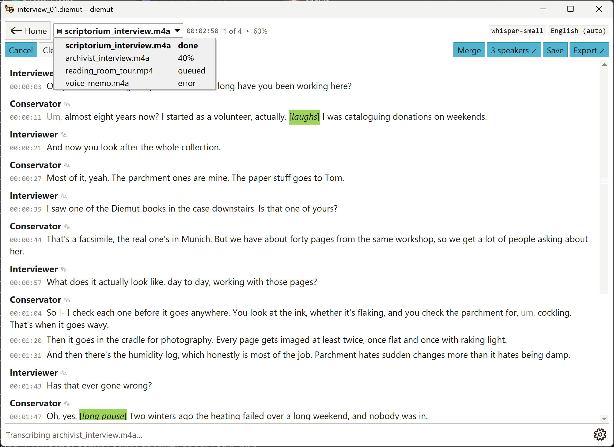
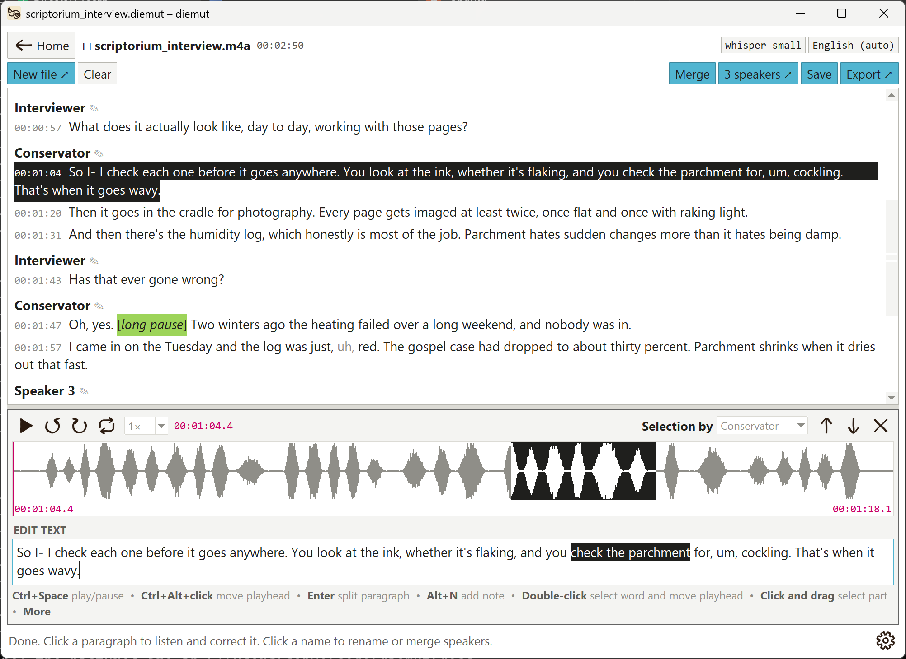
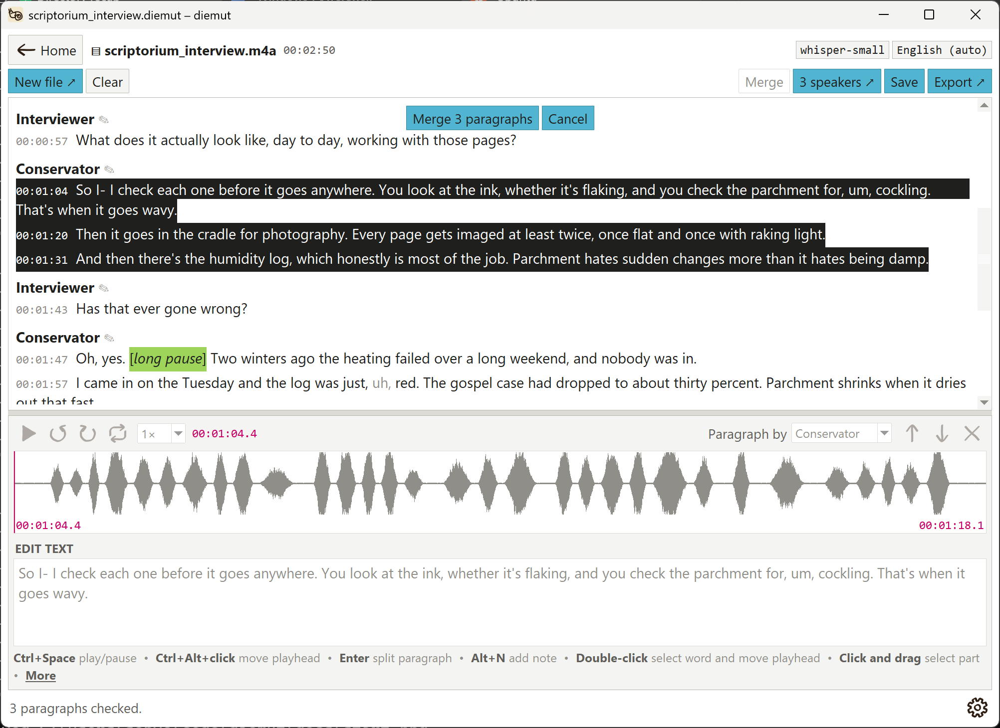
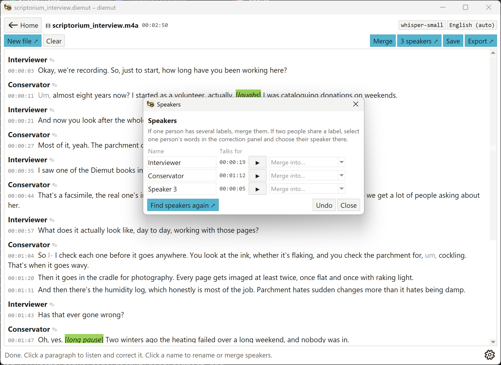
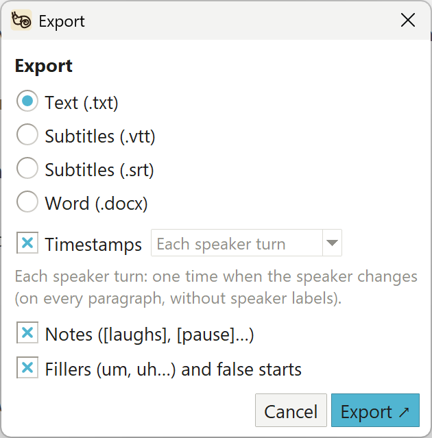
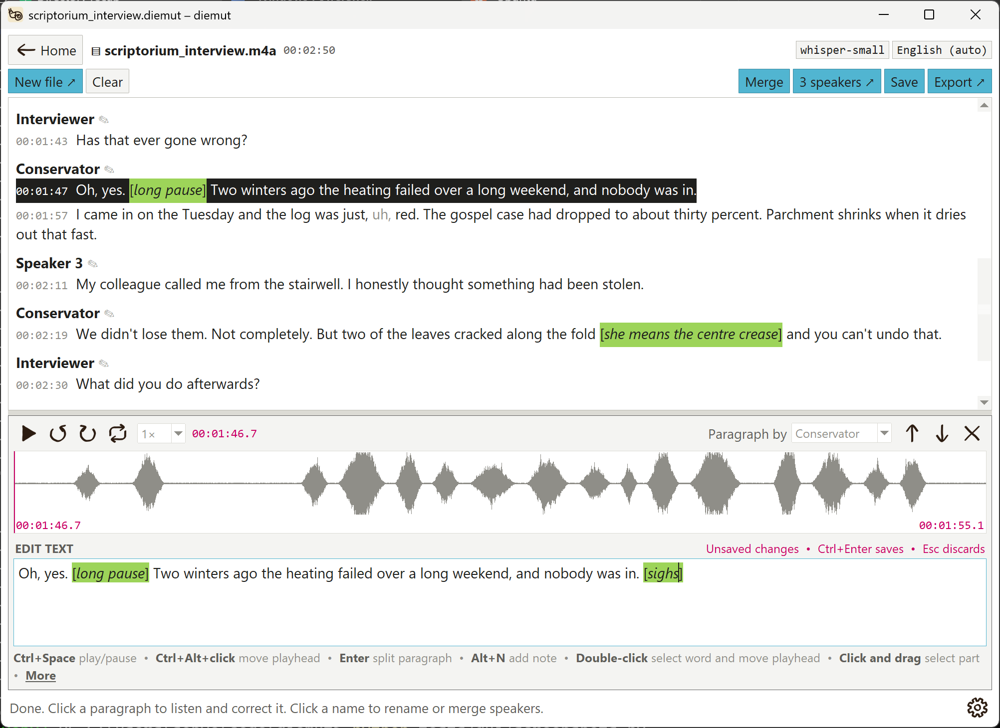
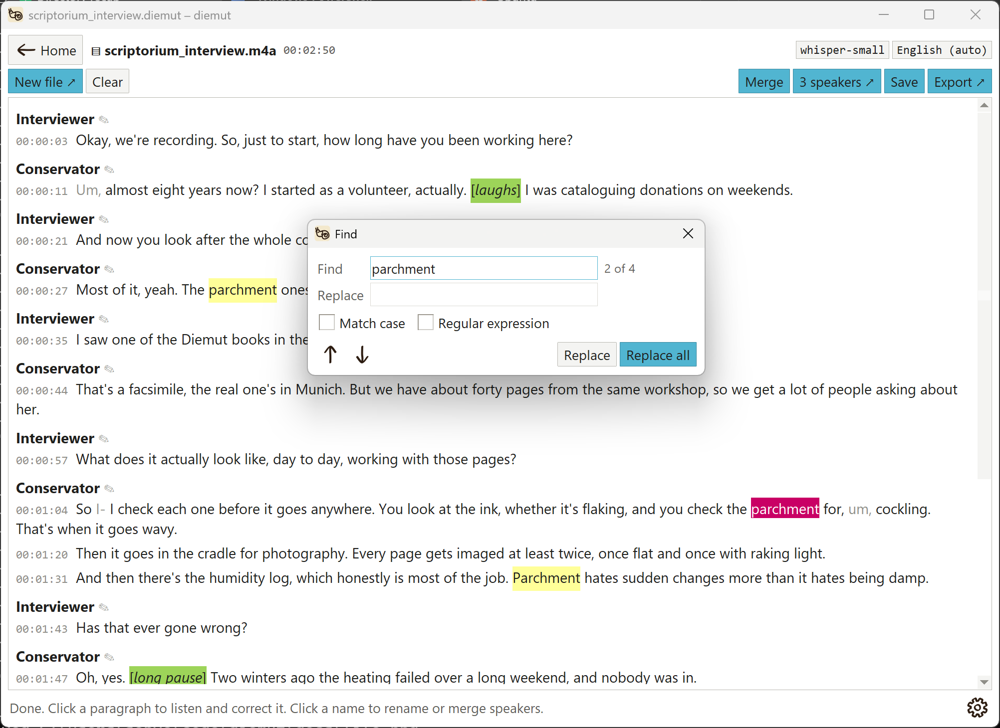

# Using diemut

How to use every part of `diemut`. For what it is and how to install it, see the [README](../README.md).

- [Start screen](#start-screen)
- [Live from microphone](#live-from-microphone)
- [Audio or video file](#audio-or-video-file)
- [Several files at once](#several-files-at-once)
- [Listening and correcting](#listening-and-correcting)
- [Paragraphs](#paragraphs)
- [Fixing speaker labels](#fixing-speaker-labels)
- [Exporting](#exporting)
- [Filler words and false starts](#filler-words-and-false-starts)
- [Notes](#notes)
- [Find and replace](#find-and-replace)
- [Undo](#undo)
- [Saving sessions](#saving-sessions)
- [Settings](#settings)
- [Choosing a model](#choosing-a-model)
- [Languages](#languages)
- [Troubleshooting](#troubleshooting)

## Start screen

Choose the **STT model** and **Language**, then pick a mode. Hover over the model names under the title to see what each one does. Small is good enough for most things, but I have noticed that Medium is indeed distinctly better. For files, you can also choose how many **Speakers** there are, if you know; this makes the speaker labels more accurate. Leave it at *Not sure* and `diemut` counts them, or choose *1 person* to skip speaker labelling. Live recordings ask after you press Stop. For live mode, the microphone is chosen in **Settings**. **Open saved session ↗** opens a session you saved earlier (see *Saving sessions* below).

## Transcribe from: Live from microphone

This *won't* capture audio coming from your laptop/machine, so note that you can't live transcribe, say, a video call. It is better to record that with another software and upload the audio to `diemut` from file. 

1. Click **Start** and speak. It records from the microphone chosen in **Settings** (the system default, unless you change it). (If the microphone you chose has been unplugged, `diemut` asks whether to use the system default.) Text appears a few seconds behind you, after each natural pause.
2. **Pause** stops listening without ending the session; **Resume** carries on. Timestamps keep counting in real time while paused.
3. **Stop** ends the session and transcribes your last few words. **Export ↗ → Audio (.mp3)** then saves the recording. Paused stretches are kept as silence, so times in the audio match the transcript.
4. Live mode doesn't label speakers while you record. After **Stop**, **Find speakers ↗** asks how many people spoke (or *Not sure*) and labels the recording, just as for a file.
5. **Mini view** (next to **Home**) shrinks `diemut` to a small window that stays in front of other apps and shows the newest two lines, the time and the Start/Pause/Stop buttons, for example as captions during a video call. **Full view** brings the whole transcript back.

## Transcribe from: Audio or video file

1. Choose a file. `diemut` transcribes it first, then finds the speakers. The progress bar shows each stage, and **Cancel** stops early but keeps what's done so far.
2. Click a speaker's name (or the **N speakers ↗** button above the transcript) to open the **Speakers** window. See *Fixing speaker labels* below.
3. **New file ↗** starts another file without going back to the start screen.

### Several files at once

Pick more than one file in the file chooser (Ctrl+click or Shift+click). A small window lists them and asks which folder to save their sessions in (the files' own folder unless you choose another); each file becomes its own `.diemut` session there, and if one with the same name exists already, the new one gets " (2)" added. The model, language and number of speakers on the start screen apply to every file.
- `diemut` transcribes them one after another, and saves each one as soon as it's done.
- The file name at the top becomes a list of the files: click it to switch to another. Beside each file it says how it's doing: done, how far along it is, queued, error or cancelled; the line next to the list shows how the batch is going.
- You can correct a finished file while the others are transcribed. Switching files saves the one you're leaving.
- Switching to a file marked error shows what went wrong where the transcript would be.
- **Cancel** asks whether to cancel just the file on screen (the one being transcribed, or a queued one) or the whole batch. Finished files are always kept. **Home**, **Clear** and closing the window ask before stopping a batch that's still running.
- **Open saved session ↗** also takes several `.diemut` files at once, with the same list to switch between them.



## Listening and correcting

Once a transcription has finished (or you've pressed Stop in live mode), click any paragraph. It's highlighted (white text on black), and a panel opens below the transcript with the paragraph's audio bar (its waveform, plus half a second either side) and its text:



Drag the divider between the transcript and the panel to give either one more room; the (editing) text box grows with the panel. `diemut` remembers the size for next time.

- As the audio plays, the word being spoken has a **faint yellow highlight** in the text box. It follows your corrections too: words you haven't changed keep their exact timing, and new or changed words are fitted in between.
- **Play / pause** plays or pauses the paragraph from the red playhead. Pausing keeps your place, and Play carries on from there. The audio bar shows the stretch's start and end times along its bottom. Hover over a button to see what it does.
- **Select some words** in the text box and press **Ctrl+Space** to hear just those words, from half a second before to half a second after. The matching stretch is tinted on the audio bar.
- **Click the audio bar** to play from that point. **Drag across it** to play a stretch; the words in that stretch are highlighted in the text.
- **Double-click a word** in the text box to select it and move the playhead to the start of that word. If audio is playing, it carries on from there; otherwise it waits for Play (which then plays the selected word).
- **Ctrl+Alt+click** (Ctrl+Option+click on a Mac) moves the playhead to exactly where you click: part-way into a word, or the start of the next word if you click between words. Any selected words are deselected, so Play starts from there. It works in the text box, and in the transcript above too, where it opens that paragraph with the playhead at the spot you clicked. If audio is playing, it carries on from there.
- The **circular arrows** jump back or forward three seconds and keep playing.
- **Loop** repeats the selected words or stretch (or the whole paragraph, if nothing is selected) until you pause. It's the looped-arrow button, and it's filled in blue while it's on.
- **Speed** plays at 0.5×, 0.75×, 1×, 1.25× or 1.5×. Voices keep their normal pitch at every speed. Let me know if you want me to add more speeds.
- Type your correction in the text box, under **Edit text**. Once it differs from the transcript, *Unsaved changes* shows above the box until you save. **Ctrl+Enter** saves it, and **Esc** discards your changes.
- **Paragraph by** (on the right, next to the arrows, when there are speaker labels) moves the paragraph to another speaker, or to a *New speaker*, when you save the correction. If you **select some words first**, it changes to **Selection by** in bold and shows those words' speaker (blank if there are several); choosing one moves just those words straight away, and the paragraph splits where the speaker changes.
- Press **Enter** in the text box to split the paragraph there.
- The **up and down arrows** step through the transcript paragraph by paragraph and save as you go. The **cross** saves and closes the panel.
- The main shortcuts are listed under the text box; **More** opens the full list.

Keyboard shortcuts, which all work while you're typing in the text box:

| Keys | Action |
|---|---|
| Ctrl+Space | Play or pause (just the selected words, if any are selected) |
| Alt+← / Alt+→ | Back / forward 3 seconds |
| Ctrl+L | Loop on or off |
| Ctrl+↓ / Ctrl+↑ | Slower / faster |
| Double-click a word | Select it and move the playhead to its start |
| Ctrl+Alt+click (Ctrl+Option+click on a Mac) | Move the playhead to exactly that spot (also in the transcript) |
| Enter | Split the paragraph at the cursor |
| Alt+N (Cmd+N on a Mac) | Add a note at the cursor |
| Ctrl+Enter | Save the correction |
| Esc | Discard your changes and close the panel |
| Ctrl+F | Find and replace in the transcript |
| Ctrl+S | Save the session (Ctrl+Shift+S saves it under a new name) |
| Ctrl+Z / Ctrl+Y | In the text box: undo or redo your typing. Elsewhere: undo or redo the last change to the transcript |

Corrections carry over to every export format. Words you didn't change keep their exact timings, and new or corrected words are fitted into the time between the words around them, so subtitle timing stays accurate. Deleting all the text in a paragraph removes it.

## Paragraphs

Every paragraph shows its start time. `diemut` starts a new paragraph after a pause of more than 1.5 seconds. To change that:
- **Merge** (on the right of the row above the transcript): the pointer becomes a needle and thread, and the paragraphs to merge are shown white on black. Click a paragraph to check it, or **drag** over several to check them all. They need to be next to each other and from the same speaker, so a drag stops where the speaker changes. **Shift+click** checks every paragraph from the last one you clicked. If you'd selected text across some paragraphs before pressing Merge, those start out checked; otherwise the open paragraph does. Then click **Merge N paragraphs**, which shows at the top of the transcript next to **Cancel** (Merge itself is faded while you merge). **Cancel** or **Esc** stops. The correction panel stays where it is but is greyed out while you merge, so nothing in it can be changed or played until you finish; afterwards it shows the merged paragraph. (While merging, clicks pick paragraphs rather than selecting text.)
- **Merge** is faded when there's only one paragraph.
- To **split** a paragraph, open it and press **Enter** in the correction box where the new paragraph should start, or right-click the word in the transcript and choose *Split paragraph before “word”*.
- You can also **right-click a paragraph** to merge it with the one above or below.
- After a merge or split, the transcript stays where it was, with the changed paragraph in the same spot on screen, and the merged paragraph stays white on black, as it was while checked, for a moment before fading back, so you can see what changed (a split's two halves do the same).



Splits and merges carry over to `.txt` and `.docx`. To copy text from the transcript, drag to select it, then press **Ctrl+C** (or right-click and choose *Copy*).

## Fixing speaker labels

For files, and live recordings once you've used **Find speakers ↗**. Speaker labelling can give one person several labels, or put two people under one. The **Speakers** window lists every speaker with how long they talk:
- Type in a name box to **rename** a speaker.
- **▶** plays a few seconds of that speaker, so you can tell who is who.
- **Merge into…** gives all of one speaker's words to another, for when one person has several labels. **Undo** reverses the last change (see *Undo* below).
- When two people share one label, open a paragraph, select one person's words and choose their speaker (or *New speaker*) in the correction panel.
- **Find speakers again ↗** relabels the whole file from the audio. It asks how many people speak (or *Not sure*). It replaces speaker names, merges and changes, but keeps your text corrections.

The window stays usable while speakers are being found, and **Cancel** stops straight away.



## Exporting

Click **Export ↗** and choose *Text (.txt)*, *Subtitles (.vtt)* (for web video players), *Subtitles (.srt)* (for most video players and editors; speakers appear as “Name: ” before their words) or *Word (.docx)*. In the same box, **Timestamps** (ticked unless you untick it) adds times to `.txt` and `.docx`: *Each speaker turn* (one time each time the speaker changes, or on every paragraph if there are no speaker labels) or *Each paragraph*. Untick it for a transcript without times. Subtitles always have times. **Notes** (ticked unless you untick it) keeps your notes in every text format; in `.docx` their words are in italics. In live mode, *Audio (.mp3)* saves the recording itself (about 28 MB an hour).



## Filler words and false starts

For English, `diemut` transcribes word for word: it keeps "um", "uh" and false starts like "it was- it was" (Whisper usually tidies these away). In the transcript they're shown in grey. To leave them out of an export, untick **Fillers (um, uh…) and false starts** in the Export dialog; your transcript keeps them. It stays as you left it until you close `diemut`. Only non-word fillers (um, uh, er, ah, hmm, mm…) are left out; words like "like" and "you know" stay, because they're often meant. A single word repeated for emphasis ("very, very good") stays too.

## Notes

A note is something you write into the transcript that nobody said: a pause, laughter, a cough, or what someone meant ("[she means the 2019 study]"). Type it in square brackets in the correction box, or press **Alt+N** (**Cmd+N** on a Mac) to get `[]` with the cursor inside, or right-click a word in the transcript and choose *Add note after "word"*. Notes are highlighted in lime, with their words in italics, so they never look like speech. A note takes no time: it sits right after the word before it, and the words around it keep their exact timings. To change a note, edit it in the correction box; to remove one, delete it there or right-click it and choose *Delete note*. Find searches notes too.



## Find and replace

**Ctrl+F** opens a small Find window (starting with any text you'd selected). As you type, every match in the transcript is highlighted in yellow, and the current one in pink; **Enter** or the down arrow goes to the next one and **Shift+Enter** or the up arrow to the previous one. Speaker names and times aren't searched. **Match case** tells "Ann" from "ann"; **Regular expression** lets you search with a [Python regular expression](https://docs.python.org/3/howto/regex.html), for example `\bAnn\b` for "Ann" but not "Anna". **Replace** changes the current match and goes on to the next, and **Replace all** changes every match at once (for example, fixing a misspelled name everywhere). What you type in the Replace box goes in exactly as typed. Like a correction, words you didn't change keep their timings, and each replace is one step for **Ctrl+Z**. **Esc** closes the window.



## Undo

**Ctrl+Z** undoes the last change to the transcript, and **Ctrl+Y** (or Ctrl+Shift+Z) redoes it: a saved correction, a paragraph split or merge, a speaker change, a rename or merge in the Speakers window, a replace, or new speaker labels from *Find speakers again ↗*. Up to 30 changes are kept. While you're typing in the correction box, Ctrl+Z undoes your typing instead; the transcript's undo is also in the right-click menu and the Speakers window. Starting a new transcript or opening a session starts a fresh undo history.

## Saving sessions

**Save** (next to Export ↗, or **Ctrl+S**) keeps everything as a `.diemut` file: the transcript, your corrections, speaker names, paragraph splits and merges, and the audio, so you can open it again later from the start screen with **Open saved session ↗** and carry on listening and correcting. The first save asks where to put it; after that, Save updates the same file, and **Ctrl+Shift+S** saves it under a new name. The window title shows the file's name, with a `*` in front while there are changes you haven't saved. A `.diemut` file is about 25 MB per hour of audio (the audio is kept losslessly) and stays on your computer like any other file.

If you go back, clear, open something else or quit with unsaved changes, `diemut` asks whether to **Save**, **Don't save**, or **Cancel**. Exporting doesn't count as saving: an exported file can't be opened again for correcting.

While there are unsaved changes, `diemut` also keeps a recovery copy every 30 seconds, in `~/.cache/diemut/recovery` (or `$DIEMUT_HOME/recovery`). If it closes without saving, for example after a crash or a power cut during a live recording, the next start offers it back: **Open it**, **Delete it**, or **Not now**. The copy is deleted once you save or choose *Don't save*.

**Clear** removes the transcript from the window, after asking about saving if there are unsaved changes.

## Settings

The cog at the bottom right of every screen opens Settings. Changes apply straight away and are remembered the next time you open `diemut`:
- **Microphone**: what live mode records from. *System default* is the one your computer uses. A headset plugged in after `diemut` started shows up in the list too. A change takes effect at the next **Start**.
- **Speech-to-text engine**: *Automatic* (the default) picks the fastest one this computer can use: faster-whisper on an NVIDIA graphics card, otherwise OpenVINO if it's installed, otherwise faster-whisper on the processor. Or choose one yourself. See *Choosing a model* for adding OpenVINO.
- **Show hover hints**: the short explanations that appear when the mouse rests on a button or box.
- **Hand-drawn icons**: the ink drawings on the buttons. Untick it for plain symbols.

They're saved in `settings.json` in `~/.cache/diemut` (or `$DIEMUT_HOME`), next to the speaker models.

## Choosing a model

| STT model | Download | Good for |
|---|---|---|
| tiny | ~75 MB | Quick tests; slower laptops |
| base | ~145 MB | Clear speech in quiet rooms |
| **small** (default) | ~480 MB | Most uses, including live mode |
| medium | ~1.5 GB | Better accuracy for files; may lag in live mode |
| large-v3-turbo | ~1.6 GB | Near-best accuracy for files on a strong computer |
| large-v3 | ~3 GB | Best accuracy; slow without a GPU |

For languages other than English, the larger models are noticeably more accurate.

**Rough speed on a typical laptop CPU** for one hour of audio: small takes about 15–25 minutes, and large-v3 can take over an hour. Speaker labelling adds a few minutes. This varies a lot between computers.

**GPU (optional):** if you have an NVIDIA graphics card with CUDA 12 and cuDNN 9 installed, `diemut` uses it automatically. If the GPU doesn't work, `diemut` quietly switches to the CPU.

**Faster on Intel computers (optional):** on a computer with an Intel processor or Intel graphics (such as Intel Arc), the OpenVINO engine is several times faster: on one Intel Arc laptop, a recording transcribed at 22 times real time instead of 7. To add it, run this once in the `diemut` folder, with the virtual environment active, then restart `diemut`:

```
pip install -e ".[openvino]"
```

With **Speech-to-text engine** on *Automatic* (in **Settings**), `diemut` then uses it on its own: on the Intel graphics card if there is one, otherwise on the processor. The first time, it downloads Intel's copy of the model (about 250 MB for small), and the first load on the graphics card takes a little longer while it's prepared. If OpenVINO doesn't work, `diemut` uses faster-whisper instead.

The tag at the top right of a transcript says which engine made it and where, such as **OpenVINO · GPU** or **faster-whisper · CPU** (for transcripts made since `diemut` started). AMD graphics cards and NPUs can't be used yet.

## Languages

Whisper supports 100 languages. The dropdown lists the **best supported** ones first, followed by every language from A to Z.

- **Auto-detect** guesses the language from the first 30 seconds of audio and uses it for the whole recording.
- **Multiple languages** re-detects the language every ~30 seconds. This works well when speakers switch between languages from sentence to sentence. Switching *within* a sentence isn't handled well.

## Troubleshooting

**`py` or `python` isn't recognised, or opens the Microsoft Store.** Python wasn't added to PATH. Rerun the installer, choose *Modify*, and tick *Add Python to environment variables*.

**"Microphone unavailable", or live mode hears nothing.** Check the Windows microphone settings in step 6 of the Windows setup. Also check which microphone is selected as the default under Settings → System → Sound → Input.

**A model download fails.** Check your internet connection. Some university networks block Hugging Face or GitHub downloads; try another network, or ask IT to allow `huggingface.co` and `github.com`.

**Speaker labels split one person into two, or merge two people.** Speaker detection works best with clear audio and people taking turns. You can adjust `SPEAKER_THRESHOLD` in `diemut/speakers.py`: higher means fewer speakers, lower means more. After editing the code, run `pip install .` again.

**Live mode falls behind.** Pick a smaller STT model, such as small or base.

**Updating diemut.** In the `diemut` folder, with the virtual environment active, run:
```powershell
git pull
pip install .
```
If you downloaded the ZIP, download the new ZIP and replace the old folder instead of running `git pull`.
